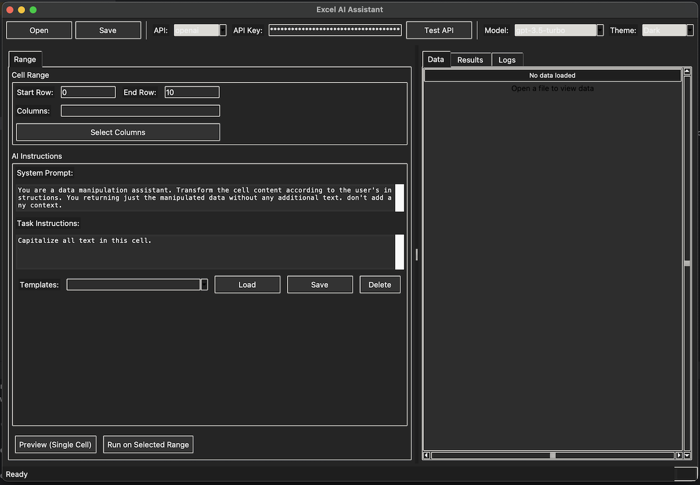

# Excel AI Assistant

A desktop assistant for reviewing AI transformations of spreadsheet text. Load a file, choose cells and optional context, generate proposals, then apply only the changes you approve.



**Status: development beta.** An isolated Windows Python 3.14 wheel installation and representative advanced workbook preservation are tested locally. Live-provider compatibility, real customer macro workbooks and other platforms still need release validation. See [the product and readiness review](docs/product-readiness-review.md) and [workbook compatibility](docs/workbook-compatibility.md).

The prepared version is **1.0.0b1**. See [GitHub release readiness](docs/github-release-readiness.md) for the findings fixed, local evidence and remaining publication gates. Release automation creates a draft prerelease after checks pass.

## Install and run

Use Python 3.13 or newer with Tkinter. On Linux, install your distribution's Tkinter package if it is absent.

```powershell
python -m venv .venv
.venv\Scripts\Activate.ps1
python -m pip install .
excel-ai-assistant --check-install
excel-ai-assistant
```

Run installation from this repository directory. On macOS/Linux, activate with `source .venv/bin/activate`. `python -m app` also launches the installed app; `python main.py` remains available from the checkout. `--check-install` checks package imports and a real Tk window without sending data to a provider. A desktop display is required. The installer downloads dependencies unless you supply a complete local wheelhouse with `--no-index --find-links <directory>`.

The historical `uv.lock` retains its earlier Python 3.13 dependency versions; its metadata is aligned, but it has not been regenerated or verified with uv for Python 3.14. Use the pip installation above for the verified path.

For OpenAI, enter your API key in the app for the current session, set `OPENAI_API_KEY`, or copy `.env.example` to a local `.env` file and fill it in. The app does not save API keys in preferences. A legacy key in an existing preferences file is available for that session and removed when preferences are next saved. Protect your `.env` and backups; neither is encrypted by the app.

For OpenRouter, select **openrouter** in the toolbar's API selector, paste your key in **OpenRouter Key**, and enter a model ID such as `openai/gpt-4o-mini`. Click **Test API** to check the selected key/model (this sends a small request and may incur charges). You can also set the key and model in **Preferences → API → OpenRouter Settings**. The key stays in the current session; the model preference is saved separately from OpenAI and Ollama. To supply the key on startup, set `OPENROUTER_API_KEY` in your environment or local `.env` file.

OpenRouter processing sends selected cells, context and prompts to OpenRouter and its upstream model provider. The transfer confirmation identifies this destination. Any account-supported text model ID in `provider/model` format can be entered; availability and charges depend on the model and account. Integration follows the [OpenRouter API reference](https://openrouter.ai/docs/api/reference/overview). Live OpenRouter requests have not been validated locally.

For Ollama, install and run your own server and select an installed model. The default URL is `http://localhost:11434`. An Ollama server at a remote URL receives your data remotely; selecting Ollama alone does not guarantee local processing.

## Workflow

1. Open `.xlsx`, `.xlsm`, or `.csv`. Choose an Excel worksheet from the selector above the data tabs. Switching sheets asks before discarding unsaved edits. Each worksheet uses its first row as headers. Convert legacy `.xls` files to `.xlsx` first.
2. Choose the provider and model. The model field accepts custom IDs; availability is determined by your provider/account.
3. Select visible row numbers: the first row is **1**, and the end row is inclusive. Use `end` to include the final row. Column selection handles headers containing commas.
4. Enter an instruction and select any context columns. Cancelling the context dialog cancels the run.
5. Confirm the destination, model, cell count, and columns that will be sent. Only the selected cells, selected context and prompts are sent for generation.
6. Review proposed changes. Select individual proposals or Select All, then Apply Selected. Discard leaves your data unchanged. Failed cells are not applied.
7. Save explicitly, or enable **Save after I apply reviewed results**. This option is off by default. Existing destination files receive a rotating `.bak` copy before replacement.

A preview also requires confirmation and applies only if its source document and cell are unchanged. Generation is sequential, with at most 10,000 cells in a run. Local request limits pause the job rather than failing all later cells. Cancellation stops waiting/starting further work; a request already sent may finish and may be billed. Completed proposals remain available for review after cancellation.

## Data protection and recovery

- File writes use a temporary sibling file and replacement. A failed save leaves edits in memory.
- The app checks whether the source file has changed outside the app and refuses conflicting saves. This is conflict detection, not an exclusive file lock: avoid simultaneous editing in Excel.
- If a save is blocked, use **Export Data Snapshot** to another path to retain current values without modifying the original workbook. Snapshots contain values and headers only, without workbook formatting or macros.
- **Undo Last Cell Edit** reverses up to 10,000 unsaved cell edits in the current session, one cell at a time. Saving clears undo history. A `.bak` contains the previous saved file; it is overwritten by the next successful save to the same destination.
- Unchanged Excel formulas remain formulas; formulas are displayed as expressions and are not recalculated by the app. Edited/generated strings are saved as text, including strings beginning with `=`.
- CSV data loads as text to preserve identifiers such as `0012` and literal `NA`. CSV exports prefix potentially executable text beginning with `=`, `+`, `-`, or `@` with an apostrophe, including after leading whitespace. This deliberately changes those exported strings for spreadsheet safety.
- Excel saves patch the reviewed cell XML inside the original workbook package. Unrelated parts, including charts, images, tables, comments, drawings, VBA and unknown extensions, retain their original payloads. Keep the original `.xlsx`/`.xlsm` extension. Document-signed workbooks, protected sheets, grouped formula outputs, pivot outputs, rich values and non-anchor merged cells are guarded against unsafe edits. Use a snapshot when an edit is blocked. See [the exact tested support contract](docs/workbook-compatibility.md).
- **Export Results** writes a separate report containing original values, proposals and failures. Reports, backups and optional logs can contain sensitive information; store them accordingly. Logging to disk is off for new configurations.

## Scope and limitations

This is a text transformation assistant, not a complete spreadsheet editor or an autonomous analyst. AI answers require human review. Numeric/date analyses are limited by the loaded data types, and CSV columns remain text. There is no schema validation, guaranteed output accuracy, enforceable spending cap, crash recovery for unsaved proposals, durable audit trail, parallel generation or automatic retry. Timer auto-save and parallel/retry controls are disabled; unimplemented appearance controls are hidden.

The interface displays 1,000 rows by default, configurable in Preferences. Selecting a processing range can include rows beyond the displayed preview. Source files are loaded into memory, so very large files are outside the current release scope. Excel package limits are 512 MiB uncompressed overall, 128 MiB per part and 50,000 parts. The app does not run VBA, calculate formulas, resize tables or refresh pivot/chart caches and external connections; use Excel for those operations.

## Repository layout

- `app/` — desktop application
- `tests/` — unit and desktop checks
- `scripts/` — release checks and sample workbook generation
- `docs/` — setup, compatibility, screenshots, and release notes
- `design/mockups/` — interface mockups used by the screenshot gallery

## Verification

```powershell
python -m pip install -r requirements-test.txt
python -m unittest discover -s tests -v
python -m compileall -q app main.py tests
python scripts/generate_workbook_samples.py
```

The sample generator produces a real workbook with a chart, image, table, formulas, styles, comments, validation, merged cells and multiple worksheets; an edited copy; and a SHA-256 package preservation report in `.artifacts/workbooks`. It requires the test dependencies.

Desktop tests require a display. On headless Linux use `xvfb-run -a python -m unittest discover -s tests -v`; without a display those tests skip. CI builds and installs a wheel, checks both launchers outside the checkout and runs tests against the installed package on Windows/Linux with Python 3.13 and 3.14. That matrix must run in your repository before those environments are considered verified.

[MIT license](LICENSE) | [Ollama setup](docs/ollama_setup.md) | [UI mockups](docs/mockups_gallery.md)
