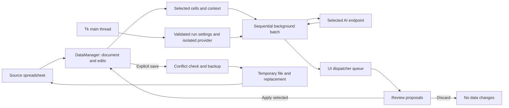

# Product, architecture and readiness review

Reviewed 2026-10-11 against the local source and desktop tests. Product positioning below is an inference from the implemented workflows, not customer research or evidence of market demand.

## Decision

Treat this as a development beta for supervised text transformation of modest spreadsheets. It should not be advertised as production-ready, a complete Excel editor, a guaranteed private service, or a reliable autonomous data-cleaning system. The critical local safeguards identified in this review have been implemented and tested. Broader release validation remains necessary.

## Assessment by dimension

| Dimension | Finding | Changes made | Remaining evidence/work |
| --- | --- | --- | --- |
| Product vision | The useful workflow is selecting spreadsheet text, generating proposals with optional context, then reviewing changes. Immediate mutation and unrelated placeholder controls obscured that workflow. | Introduced review/select/apply/discard; disabled default auto-save; removed no-op Copy/Paste menu entries; implemented results export; hid or disabled unimplemented settings; corrected row selection to visible row numbers. | Validate the target workflow with actual spreadsheet users before expanding analytics or editor features. |
| Product fit | Templates, context and provider choice plausibly help repeated text normalization, but source code cannot establish demand, retention or willingness to pay. | Narrowed README claims and documented limits for worksheet coverage, CSV types, privacy and supported workbook features. | Observe users completing real tasks; measure time saved, reviewed-proposal acceptance, error rate, repeat use and whether users understand the sending destination. |
| Architecture | The large main-window controller combines UI, document state, provider configuration and background work. Shared mutable clients and Tk calls from worker threads created correctness risks. | Added a queue-based UI dispatcher, shared immutable processing settings, isolated provider instances per job/settings lookup, document identity checks, and an operation guard. | Further split the main controller into document, processing and review controllers. Introduce a typed provider protocol and a central workflow state model if workflows expand. |
| Reliability | Overlapping work, malformed preferences, partial provider replies, zero/negative settings and local rate limits could corrupt the experience. Preferences also crashed from mixed layout managers. | Blocked overlapping document operations and busy edits/close; fixed layout crashes; validate settings/configuration; bounded provider timeouts; reject incomplete/empty output; wait for local rate windows; retain partial proposals on cancellation. | Test live provider limits, disconnects and cancellations; bounded timeouts do not terminate an already-running server request. No resumable or crash-recoverable jobs. |
| Safety | Keys were persisted in plaintext; AI text could become Excel formulas; source changes could be silently overwritten; type inference damaged identifiers; workbook rewrites could strip advanced objects. | Session/environment keys; atomic preferences; formula-as-text; safe CSV export; identifier-preserving load; source hashes; backups; package-preserving Excel cell saves; guards for signatures, protection, grouped formulas and pivot output; recovery snapshots. | Real customer macro/workbook corpus, dependency vulnerability scan, optional OS credential storage and stronger external-edit coordination. Preserving active content does not sanitize it. |
| Control | Users could lose the distinction between generation, applying and saving. Cancelling context could still start requests; stale previews could update another file. | Explicit send confirmation for preview/batch; original/proposed review with selective apply/discard; separate save setting; undo unsaved cell edits; result export with failures; context Cancel aborts; document/cell checks on preview apply. | Durable approved-change history, schema validation, per-cell validation and optional enforceable run/account budget integration. Undo is per cell, memory-only and cleared at save. |
| Product readiness | No installed-package readiness gate or accurate support contract was present. Dependency lists disagreed and included unused packages. | Added installable wheel and launcher, installation diagnostics, representative workbook generator and preservation tests; removed unused plotting/tooltip dependencies; verified an isolated Windows Python 3.14 installation from cached wheels; configured CI to test installed wheels outside the checkout. | Run normal network installs and the CI platform matrix, vulnerability scanning, accessibility and large-file checks. The historical uv lock still needs tool validation/regeneration. |

## Current boundaries and data flow

Workers post results into a queue; Tk polling drains that queue on the main thread. Provider/model/settings are captured before launching a job. Document-changing operations are guarded while loading, saving, generating, or reviewing. Background generation produces proposals; it cannot write source files. Source file persistence is owned by the data service. The UI controller still coordinates the lifecycle and remains the main architectural debt.

Provider output is treated as data, with no generated code execution or tool invocation. Prompt injection can still distort a proposed answer; output review is not semantic correctness verification. Keys are not saved in preferences, but user-managed environment files, reports and backups are not encrypted.

## Verification performed locally

- Automated regression, safety, configuration, provider-response and actual Tk desktop tests, using synthetic spreadsheets and mocked generation.
- Desktop paths include Preferences creation/application, isolated Ollama settings, UI-thread dispatch, the asynchronous batch-to-review flow, selective application, discard, stale preview blocking, busy edit rejection and visible row/column selection.
- Spreadsheet tests include real charts/images/tables/styles/comments and other worksheet preservation; unknown extensions and opaque advanced parts; synthetic VBA payload preservation; grouped formulas, pivot outputs, signatures and protection guards; blank-cell insertion; stale calculation-chain removal; atomic failures; backups; external conflicts; identifiers; and formula neutralization. See [workbook compatibility](workbook-compatibility.md) for the exact evidence and limitations.
- Dependency manifests and root lock metadata are checked for consistency, and lock references must resolve to included package records.
- Python source compilation.

This environment runs Windows with Python 3.14. All 74 tests pass against an installed wheel in an isolated environment with freshly installed cached dependencies; both launchers pass the real Tk installation check and pip reports no broken requirements. Local build/install required a workspace temporary-directory adapter for this managed environment's directory restrictions. Live OpenAI/Ollama generation, normal network installation, uv lock-tool validation, Linux/macOS execution and executable macro fixtures were not exercised. CI defines normal wheel installation and installed-package testing on Windows/Linux Python 3.13/3.14; that matrix has not run here.

## Release gates still open

1. **Live-provider matrix:** exercise supported model IDs with small synthetic data; verify complete output, errors, rate waiting, cancellation and account-level budgets. Provider availability is account-dependent; editable model IDs avoid silently substituting another model.
2. **Workbook contract:** generated representative workbooks now cover formulas, merged cells, hidden sheets, dates, comments, names, charts, images and tables. Add real customer macro/slicer/pivot/connection fixtures and open saved results in Microsoft Excel. Keep unsafe cell edits blocked and offer snapshots for unsupported documents.
3. **Distribution and supply chain:** extend isolated Windows installation evidence to normal network installs and the CI matrix; run vulnerability scanning and regenerate/validate the historical uv lock; build/sign/test installers if distributing executables. Dependencies are not security-audited.
4. **Product validation:** test real users on capitalization, translation and categorization workflows. Establish a baseline task time and acceptable reviewed-output error rate. Validate that users understand context selection, transfer confirmation, review, save and backup recovery.
5. **Operational limits:** measure load time, memory use, UI responsiveness and provider behavior on the largest supported files. The 10,000-cell run limit bounds request count, not total file size, account spending or generated-output memory.
6. **Recovery and governance:** decide whether crash recovery, persistent audit history, policy enforcement and OS key storage are necessary for the intended audience. The current tool is a single-user desktop app with memory-only proposal and undo state.

No market-fit claim or production-readiness certification is supported by this review. The implementation is safer and more reviewable, with explicit limitations and testable release gates.
